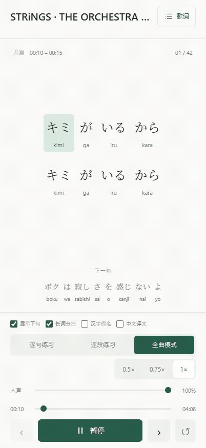
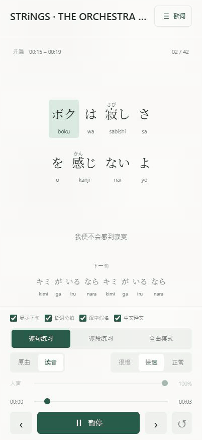
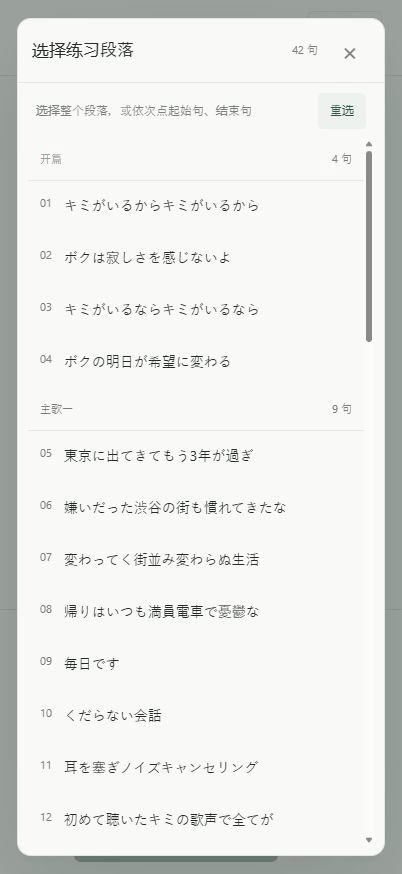

# Sorane Player

[更新日志](CHANGELOG.md)

日语歌词练习播放器。支持全曲、逐句、逐段循环，原曲与读音、三档速度、人声音量、假名、译文、本地收藏。

播放器读取歌曲包，提供同步歌词、循环练习和读音辅助。制作歌曲包使用关联项目 [Sorane Studio](https://github.com/SuperJuice666/sorane-studio)。两者独立运行，以 [schemaVersion 1](docs/data-format.md) 交换数据。

[在线演示](https://superjuice666.github.io/sorane-player/?song=strings) · STRiNGS — THE ORCHESTRA TOKYO

<p>
  
  
  
</p>

全曲同步 · 逐句读音 · 选段循环。录制视口为 iPhone 17 Pro 对应的 402 × 874。

## 本地运行

需要 Python 3.12 或更新版本。下载完整源码，进入项目根目录：

```sh
git clone https://github.com/SuperJuice666/sorane-player.git
cd sorane-player
python -m lyric_player demo
python -m lyric_player build
python -m server
```

打开 <http://127.0.0.1:8080>。演示包含本项目编写的音调和示例文字。
运行与构建使用 Python 标准库，Node.js 提供开发检查。

## 添加歌曲包

将 Sorane Studio 交付的完整歌曲目录放入 `data/songs/<id>/`，保留相对路径：

```sh
python -m lyric_player validate data/songs/my-song/song.json
python -m lyric_player build
```

构建结果为 `build/`，可部署到静态服务器。`server/` 提供本地预览服务。见[部署](docs/deployment.md)。网站根目录设为 `build/`。

## 项目结构

| 目录            | 内容                       |
| --------------- | -------------------------- |
| `web/`          | 播放器和分块音频调度       |
| `server/`       | 静态网站预览服务           |
| `lyric_player/` | 曲库构建、校验器和音调示例 |
| `examples/`     | 歌曲包示例                 |
| `docs/`         | 格式、架构、部署和维护     |
| `tests/`        | 播放时序、格式和服务测试   |

个人歌曲和构建结果分别保存在 `data/` 和 `build/`。

## 开发

```sh
python -m pip install -r requirements-dev.txt
npm ci
npm test
npm run lint
npm run format:check
python -m unittest discover -s tests
python -m ruff check server lyric_player tests
python -m ruff format --check server lyric_player tests
```

音频修改还需按[维护说明](docs/maintenance.md)做设备检查。歌曲包兼容与版本协作见[两个项目如何协作](docs/relationship.md)。

代码采用 MIT。内置字体使用 OFL，见 `web/fonts/OFL.txt`。歌曲内容需自行取得相应使用权限。
